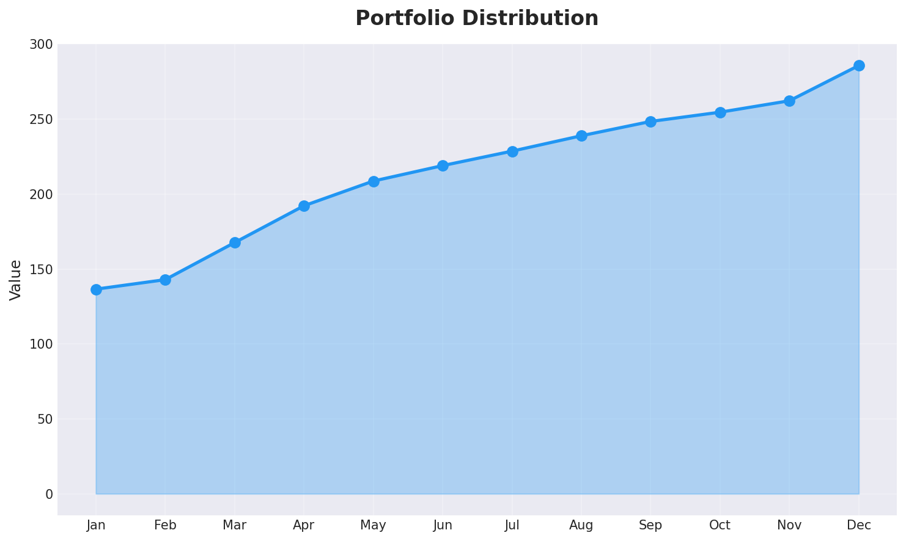
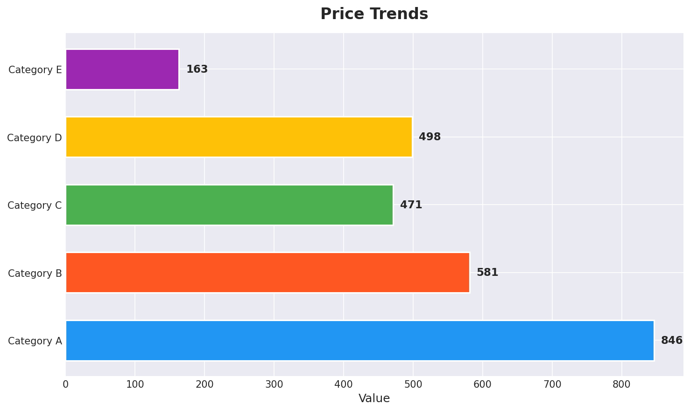
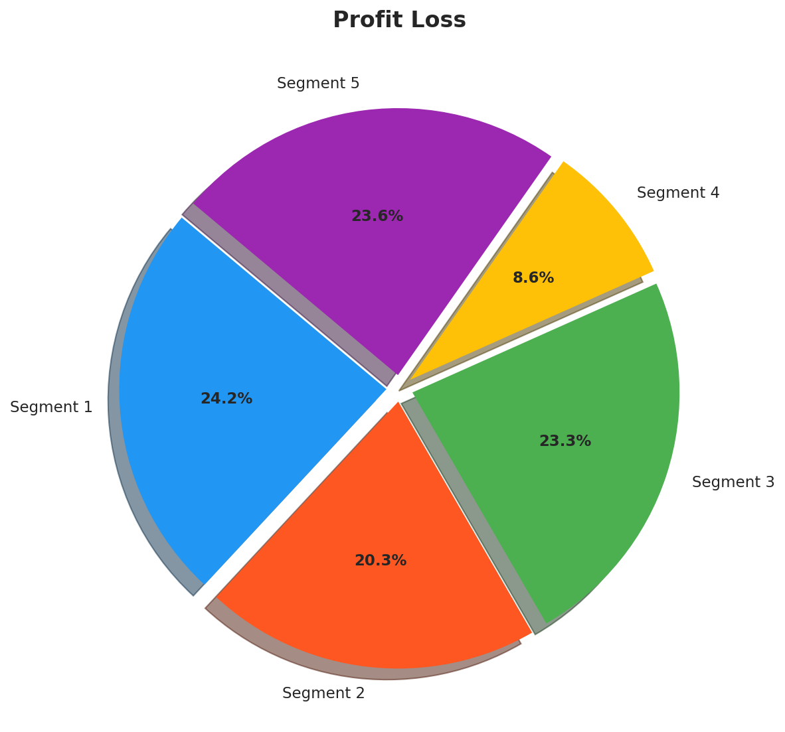
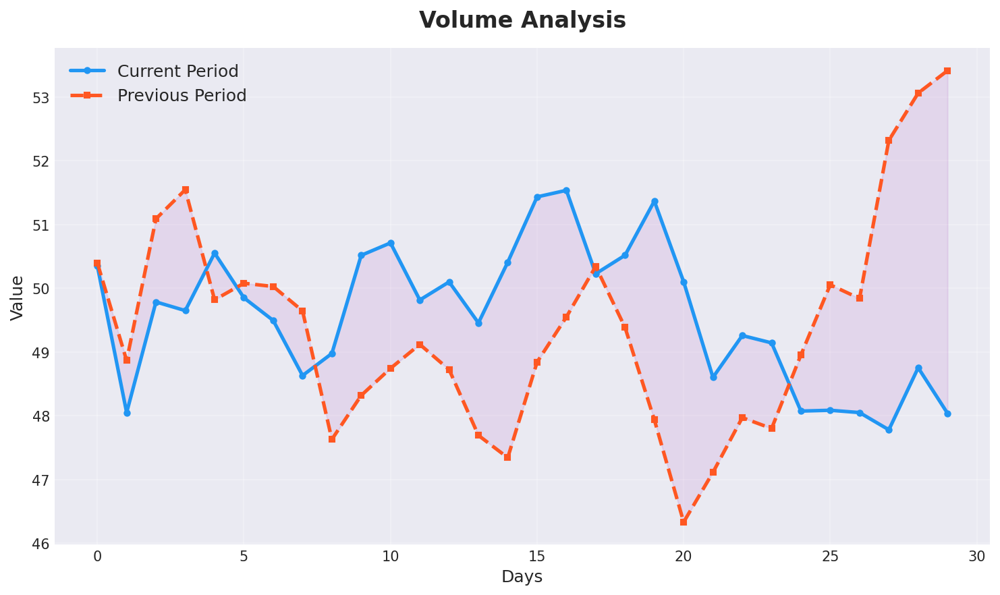

# Crypto Portfolio Dashboard

A production‑ready Streamlit dashboard that visualises a cryptocurrency portfolio. 
It displays holdings, market trends, profit/loss analysis, and volume insights with interactive Plotly charts.

## Features

- **Sidebar navigation** with clean multi‑page layout
- Real‑time style visualisations:
 - Portfolio distribution (pie chart)
 - Historical price trends (line chart)
 - Profit / loss per asset (bar chart)
 - Daily trading volume (stacked area chart)
- Sample data generator for quick prototyping
- Typed utilities and dataclasses for maintainability
- Unit tests covering data loading and metric calculations

## Screenshots

| Overview | Trends |
|---|---|
| | |

| Analysis | Volume |
|---|---|
| | |

## Getting Started

### Prerequisites

- Python 3.9+
- Git (optional)

### Installation